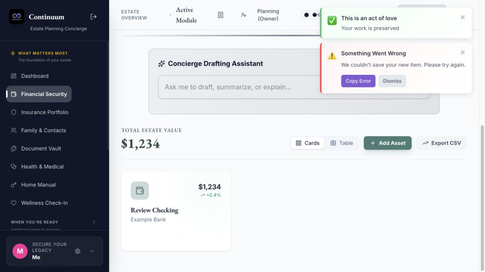
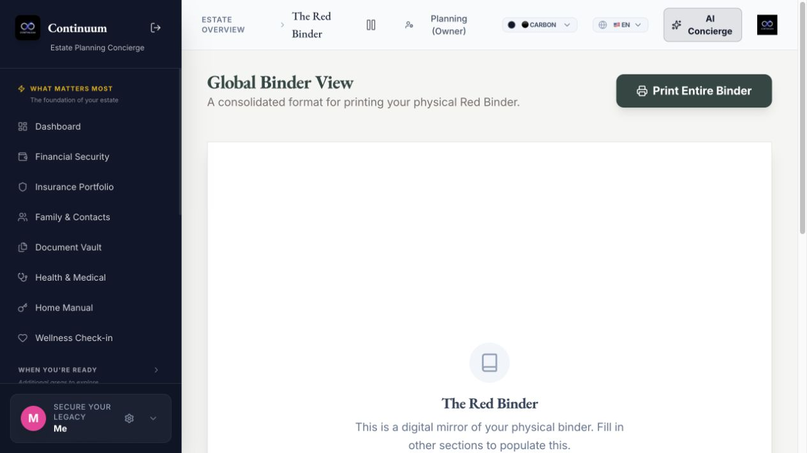
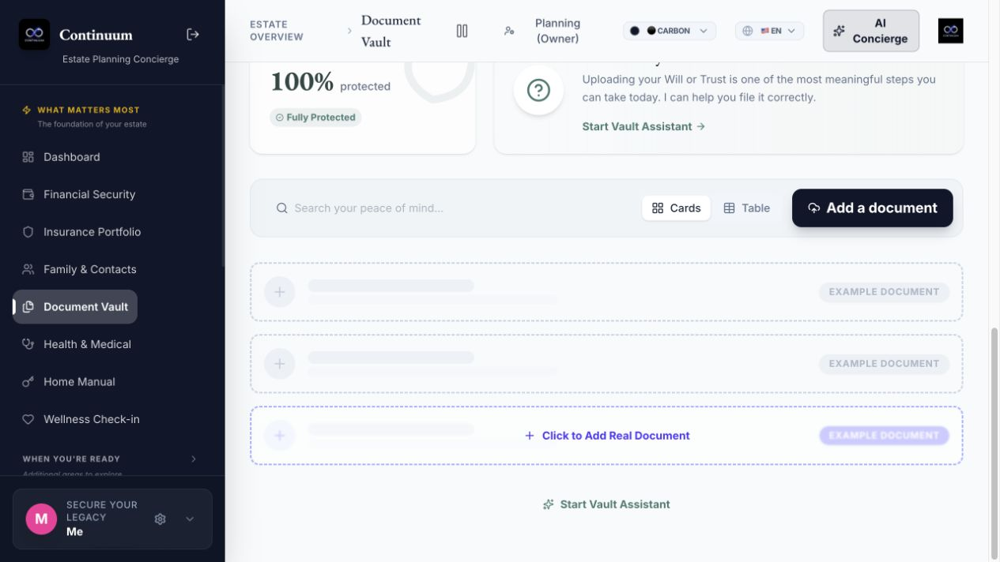

# Continuum: feature and usability recovery review

Review started October 25, 2026. Scope: the active local application, with Jonathan's stated goal of leaving his legacy and financial information to his son. Security hardening and administration were deliberately excluded from prioritization.

## Assessment

**Keep the existing application and repair the core journeys. It has substantial useful feature scaffolding, but it does not yet provide a dependable handover to your son.** The largest problems are disconnected data contracts, incomplete exports, and a missing coherent recipient experience. Additional modules and more elaborate visual design would not resolve those problems.

The application already has places for accounts, insurance, contacts, legal documents, property, household instructions, letters, reflections, memories, heirlooms, and final wishes. These are appropriate building blocks. Unfortunately, a screen looking complete often says little about whether its fields save or whether another screen reads the same records.

Three examples were reproduced:

- A financial account saves its name and amount while silently discarding identifying and handover fields. The interface can show a success notification and a failure notification together.
- An empty document vault reports **“100% protected” / “Fully Protected.”** Its actual screen calls an unsupported API type, and saving a document fails.
- After saving a synthetic checking account, the printable binder still has no account section. The separate “full” PDF generator does not include financial accounts, letters, or journal entries at all.

This review changed documentation and added isolated review evidence. **No application fixes, deployment, real-data migration, external messages, or security/admin changes were performed.** All issues below remain open. This report is the evidence supplement to the concurrently maintained [canonical recovery plan](../../PROJECT_RECOVERY_PLAN.md) and [execution cards](../../RECOVERY_EXECUTION_PLAN.md), not another execution board. Its sequencing recommendations can inform those cards.

## What was reviewed and what the evidence establishes

The review inventoried all **74 Svelte page routes**, scanned the active frontend/backend source, inspected feature handlers, stores, shared persistence, APIs, models, migrations, exports, navigation, onboarding, assistance, and existing checks. The active frontend has 301 `.ts`/`.svelte` source files and about 69,000 lines. The source fingerprint includes 362 frontend/backend files, including backend migrations. The archived Next.js application and historical agent plans were treated as background, not as the active product.

Deeper checks followed the core chain: form → store → API → database model → reload → downstream display or handover. A local browser walkthrough covered login, onboarding, contacts, financial entry, dashboard, binder, and document entry. **29 isolated API probes** exercised both failures and working controls. Source-level findings are identified separately from reproduced behavior. This is a broad recovery audit, not a claim that every interaction on every route has been exercised.

At the start, HEAD was `6add028`, the working tree already had a modified `frontend/package-lock.json`, and no CodeGraph index existed. During review, a separate process created a CodeGraph index, committed repository-tooling changes as `d54633b`, reorganized documentation, and added execution cards (`c0a3403`); targeted follow-up used CodeGraph. This task did not edit those concurrent changes. Documentation references describing the starting state may use their former root locations; current guides are under `docs/`. The application findings refer to the source captured in [source-fingerprint.json](evidence/source-fingerprint.json), verified unchanged at the end of review.

### Verification results

| Check | Result | Meaning |
| --- | --- | --- |
| `cd frontend && npm run build` | Pass | Static output is generated. This does not check all TypeScript contracts. |
| `cd frontend && npm run check` | **288 errors, 268 warnings in 112 files** | Broad store/component/API drift remains. See [diagnostics](evidence/svelte-check.txt) and [per-file summary](evidence/typecheck-summary.json). |
| Backend Python AST parsing | Pass | Python files parse; this is not behavior verification. |
| Fresh isolated backend install | Runtime defect | SQLModel 0.0.48 / SQLAlchemy 2.1.6 reject naive datetime defaults during dev-user seeding. The app process can start despite the seeding failure. |
| Compatibility environment for deeper probes | Explicit local adjustment | Temporary SQLModel 0.0.31 / SQLAlchemy 2.0.55 allowed further testing. Repository requirements were not changed. FastAPI 0.162.0 / Pydantic 2.14.1; Python 3.14.8. |
| Backend test collection | 3 tests collected | Existing tests are email delivery plus two view-preference checks; no comprehensive feature suite. |
| `pytest backend/test_view_preferences.py -q` in isolated environment | **1 failed, 1 passed** | `User.view_preferences` is missing from the active model. [Output](evidence/pytest-view-preferences.txt). |
| Isolated API probes | 29 responses recorded | Confirmed unsupported endpoints, discarded fields, category mixing, contract mismatches, and passing controls. These are observations, not 29 passing assertions. |
| Local browser | Multiple core defects reproduced | Financial save feedback, missing binder content, unsupported document save, false vault readiness. |

The email-delivery test was not executed. Tests used disposable databases, fake names and example addresses, temporary uploads/outbox directories, and no real email provider. API probes used an auth dependency override and skipped lifespan startup, so they do **not** prove real authentication or recipient access. No production database or deployment was examined. Phone layouts, assistive technology, real hardware recording, actual PDF page layout, backup restoration, real scheduled delivery, and all remaining screen interactions still need hands-on verification.

## Feature inventory

“Partial” means useful code exists, not that the whole journey passed. “Source” means a code finding rather than an executed browser journey. The complete route inventory is in [route-inventory.json](evidence/route-inventory.json).

| Area | Current capability and condition | Recovery direction |
| --- | --- | --- |
| Login / initial setup | Browser entry and self-directed onboarding worked in the compatibility environment. Several overlapping onboarding/state systems exist. | Keep a short path to the first useful record; resume reliably. |
| Dashboard / navigation | Real account count appeared after entry. Numerous readiness sources, labels, and optional tools compete. “Accounts” summary links to subscriptions. | One clear overview of what is recorded, what is missing, and the next useful step. |
| Financial accounts | Name, value, institution/location, beneficiaries and notes can be saved; important camelCase fields are discarded after conversion. | Repair all field round-trips before more UI work. Add meaningful account/debt/ownership distinctions. |
| Insurance | Rich structured forms, beneficiaries, advisor details, claims instructions and documents; matching snake_case model/mappers exist. Not fully browser-tested. | Preserve this useful structure; verify create/edit/reload/attachment/export together. |
| Contacts / family tree | Dedicated contacts API, executor/beneficiary/emergency flags and relationships. Contact screen loads. | Make the son a named recipient; keep recipient, executor, advisor and emergency-contact roles distinct. |
| Legal documents | Active screen uses unsupported `vault_documents`; the supported `documents` API accepts a valid document control. Current uploader is image-only. | Connect screen and model, including real PDFs and physical-original locations. |
| Property | Rich inventory and valuation UI. Ownership/purchase fields can be dropped; evidence uses temporary URLs; category data is mixed. | Preserve durable records, ownership and attachments; separate category membership. |
| Home manual | Vendors, access codes, utilities have matching API controls that saved. UI has concise forms but incomplete editing/detail capability. | Keep and verify practical retrieval, instructions and export for the son. |
| Subscriptions | Basic name/cost/cycle save; payment and cancellation fields are discarded by naming mismatch. | Give the son usable keep/cancel instructions and associated payment references. |
| Digital accounts | Platform, username and closure intentions have a UI; actual payload can lack required Asset.name. Shares Asset rows with property/heirlooms. | A separate coherent account model or explicit validated adapter/category rule. |
| Medical | Profile values persisted in API control, but save response was `{}`; directives have dedicated APIs. | Return canonical saved data and verify reader/export agreement. |
| Pet care | Guardian, care and related forms/stores exist. No complete browser round-trip performed. | Keep as optional practical instructions; verify only after the primary handover works. |
| Letters | Templates, reflection interview, editable text, print/download and saved-letter list exist. No first-class son/child flow; reopening and saving creates another letter; release fields are dropped. | Direct “Letter to my son,” editable saved drafts and an explicit recipient/reading experience. |
| Journal reflections | Plain reflection create and normalized edit passed API controls. | Preserve the working base and improve discovery and handover. |
| Ethical will / life lessons | UI uses unsupported `ethical_will` / `life_lessons` types despite generic journal type support existing. | Reuse journal types or add real endpoints; no duplicate subsystem needed. |
| Accomplishments / life timeline | Timeline store and gallery exist; secondary gallery does not initialize its own timeline sync. | Verify direct entry and reload; make it easy to browse from a personal legacy view. |
| Visual / family memories | Dedicated memory APIs, galleries, family stories, archives, bulk actions and slideshow code. File services are inconsistent. | Durable original files with captions/dates/people; retrieval on another device is the completion test. |
| Time capsule / video | Date/milestone UI and recording exist; create includes prohibited `created_at`, playback depends on local IndexedDB, derived status expects the wrong subscription shape. | Fix creation and durable media, then accurately describe manual/scheduled release capability. |
| Funeral / final wishes | Detailed ceremony, music and budget UI; singleton client uses a collection API and a direction-dependent mapper. | One canonical wishes record that survives edits and can be read/printed. |
| Calendar / anniversaries | Shared event model and two calendar modules; derived upcoming-events code expects `.items` on an array subscription. | One source for dates; clearly separate a calendar event from delivery of a letter. |
| Executor guidance | Substantial phased task content and detail screens; toolkit completion is component-only state. | Persistent progress linked to the actual records needed for each step. |
| Son / recipient handover | Executor page changes presentation but does not select or retrieve another owner's estate. Pulse portal returns welfare status and limited flags. | Build one tested recipient entry and “start here” experience. |
| Binder / PDF | Two separate incomplete output paths; binder uses stale keys and hardcoded owner/executor names. | One export snapshot with complete practical and personal sections plus attachments/manifest. |
| Pulse | Considerable welfare/check-in/escalation code; not a complete estate handoff or letter-delivery service. Scheduler ignores its enable/interval settings. | Preserve as optional. Do not make a wellness automation the only way to reach family records. |
| QR packs / labels | Browser-local QR metadata, external image generator; pack links target absent `/access` route; asset-type comparison is inconsistent. | Keep secondary and label incomplete until scanned destination and intended record work. |
| Registry / scenarios / simulations / analytics | Multiple duplicate stores, singleton/collection mismatches, unsupported shapes, partial tabs and sample scenarios. | Defer repairs that do not unblock the core; label examples and retain discoverability. |
| AI / dictation / document/image interpretation | Some real external AI calls coexist with deterministic mock services and simulated dictation. | All core tasks must work manually; label fallback/template behavior honestly. |
| Settings / preferences | Many settings share `/estate/profile` but post the wrong envelope; view-preferences API references a missing User field. | Repair persistence and eliminate conflicting settings sources. |
| Help / grief resources / marketing / builder tools | Significant content and pages exist. Not needed to establish the first useful personal handover. | Retain; move secondary surfaces out of everyday planning. |

## Prioritized issue register

Severity here reflects **features and usability**, not security risk. P0 blocks or materially corrupts the intended handover; P1 is a major functional/UX defect; P2 improves usability or maintainability. **Every entry is OPEN.** [Exact repository source paths for each issue](evidence/issue-sources.json) accompany the shorthand names below.

| ID | Priority | Finding and evidence | Acceptance for closure |
| --- | --- | --- | --- |
| CU-001 | P0 | **Financial and related fields disappear after a successful save.** Shared snake conversion does not match camelCase fields in SQLModel. API control returned null for `accountNumber`, `ownershipPercentage`, `loginUrl`, `beneficiaryEmail`, `valueHistory`; property ownership/purchase fields and subscription instructions also dropped. Sources: `sync.svelte.ts`, `estate_models.py`, `AssetManager.svelte`. | Every displayed writable field survives create, edit, API re-fetch, browser reload and export, including zero/empty/optional values. Explicit request/response contracts. |
| CU-002 | P0 | **Important Documents cannot save through the active screen.** `DocumentVault.svelte` registers `/api/data/vault_documents`; MODEL_MAP has only `documents`. HTTP 400 reproduced; browser save failed. Merely renaming the endpoint is insufficient: screen uses name/type/fileData, model requires title/category and a file reference. | Save, list, edit, reload and retrieve both a PDF attachment and a physical-only document with all metadata. |
| CU-003 | P0 | **Handover output is incomplete.** Binder reads `assets_assets-main` instead of `financial_assets`, only includes three categories, and hardcodes Jonathan/Jane Doe. `exportService.ts` “full” PDF covers property, insurance, heirlooms, timeline and medical only; images flag is unused and heirloom stories truncate to 50 characters. Medical profile properties are read from the wrong level. Browser binder omitted the test account. | One synchronized snapshot includes all chosen records and full personal text; correct names; attachments or an explicit usable manifest; reconciled counts and original records; readable actual PDF/print output. |
| CU-004 | P0 | **Asset categories contain each other's records.** Generic `properties`, `digital_assets`, `heirlooms` all map to Asset; get_items filters only by user. Creating a property made it appear in both digital-assets and heirlooms API results. Separate Heirloom model/router also exists. | Distinct correct membership after create/update/delete and reload, with safe handling of existing mixed records. Check lists, counts, totals and exports together. |
| CU-005 | P0 | **No complete son-facing estate handover.** `/executor` uses the current account's stores; role changes do not fetch a selected owner's records. Pulse portal returns check-in status, not the estate inventory/letters/documents. Root layout treats portal routes as protected, interfering with public token flows. Source-confirmed; valid recipient access not executed. | In a separate browser context, the intended recipient reaches the correct owner's readable packet, key contacts, personal messages and attachments; understands first steps and can export. Jonathan can preview that same experience. |
| CU-006 | P1 | **Estate profile and many settings cannot save through SingletonSyncManager.** It posts a raw converted object; `/api/estate/profile` requires `{data: {...}}`. Raw payload returned 422; wrapped control passed. Multiple settings stores also share this endpoint while the server replaces the whole estate_profile value. | Profile, tone, onboarding, scenario and concierge settings round-trip without replacing unrelated fields. Contract and merging are explicit. |
| CU-007 | P1 | **Ethical will and life lessons have no supporting API types.** Their components call unsupported generic endpoints; both returned 400. Ethical will auto-attempts to create canned default text. | User-authored ethical will and lessons save/edit/reload; use existing JournalEntry types where appropriate; no sample prose becomes the user's record automatically. |
| CU-008 | P1 | **Letters lack a dependable author-to-son workflow.** Screen uses `saved_letters`/`future_letters`, while another store uses `letters`/`letters`; recipient_name is not part of the screen's saved draft. `viewLetter` loses saved-record identity and `saveToVault` always creates; triggerDate/isLocked are discarded after snake conversion. No verified release/delivery execution path. | Direct son/child recipient selection, stable editable drafts, full text preserved, explicit availability/delivery behavior, no accidental duplicates, and recipient-readable output. |
| CU-009 | P1 | **Time-capsule creation fails and recordings do not travel.** addMessage sets createdAt; conversion sends `created_at`, which create_item rejects (422 reproduced). Recordings/playback use local IndexedDB IDs. capsuleStatus expects `.items` though subscription emits arrays. | Create/edit/reload a text and video capsule; retrieve media on a fresh device/context; accurate locked/released lists and explicit release behavior. |
| CU-010 | P1 | **File handling is fragmented.** mediaService reads `access_token` while auth writes `continuum_auth_token`; downloads often expose tokenless URLs; API-base handling differs. FileUploader accepts images only; property evidence stores blob URLs and is absent from Asset's model. Sources: mediaService, auth, FileUploader, EvidenceGalleryUploader, mediaStorage. | One supported upload/retrieval path with progress/failure/retry, PDFs/images/audio/video as appropriate, durable references, and independent-reader download/playback. |
| CU-011 | P1 | **Funeral/advanced registry singleton state uses collection endpoints.** GET funeral_data returned `[]`, POST created a row, reload returned `[row]`. SingletonSyncManager assumes an object; mapper alternates JSON strings and objects. Advanced assets has the same list/object design mismatch. | Repeated saves update one canonical record, UI always receives its expected object shape, no duplicate rows, and contents survive reload/export. |
| CU-012 | P1 | **Readiness and totals do not mean what they claim.** Empty vault scores 100 because only needs_review records subtract points. estateAudit uses property as finance, a nonexistent beneficiary field, and unrelated score keys; readiness.ts and EstateNetWorth read stale keys. Financial UI treats 0% ownership as 100% via `|| 100`, generates mock history and displays a fixed +2.4%. | Shared documented calculation/membership rules, unknown/not-applicable states, meaningful financial and legacy completeness, no invented trends, matching detail lists and export totals. |
| CU-013 | P1 | **Save feedback can contradict itself.** Browser account save showed preserved + failed together. Activity log generates a UUID that shared create strips; DB has a string primary key with no generator; matching activity POST returned 400. logEvent does not await/catch the promise. Several wrappers close forms/show success before completion; create/update do not consistently set manager status. | Successful record save has one truthful result; activity-log failures are handled separately; failed primary saves keep drafts and show retry; save-state badges follow real persistence. |
| CU-014 | P1 | **Store initialization/account/profile lifecycle is inconsistent.** Store constructors load once, shared registries are keyed only by module, syncAll only sees registered stores at that moment, and most server queries have no profile dimension. Older profile-aware stores coexist. Source-confirmed risk; cross-account reproduction not performed. | Direct route, reload, login/logout and profile changes show the selected records; late-loaded modules initialize; a second context retrieves the same intended estate. |
| CU-015 | P1 | **Executor task progress disappears.** executor-toolkit completionStatus is local component state. Other executor screens use inconsistent readiness keys and placeholder estate data. | Completed tasks, notes and relevant-record links survive navigation/reload; son sees clear immediate/this-week/later steps for the correct estate. |
| CU-016 | P1 | **Calendar/anniversary derived state uses the wrong store shape.** upcomingEvents reads `$sync.items` from an array; type check flags it. Capsule has the same pattern. Two calendar stores coexist. | Upcoming events and anniversary pages load directly, handle empty/recurring dates, update after edits, and do not imply message delivery merely because a date exists. |
| CU-017 | P2 | **Long sessions can interrupt entry.** Backend access-token default is 15 minutes; frontend auth does not retain/use returned refresh tokens and auth.init clears tokens on network failure. Source finding, no timed session reproduction. | Long writing sessions recover without lost drafts; connection failure and expired session have understandable resume/retry behavior. |
| CU-018 | P1 | **Primary information architecture underserves this project.** Financial and practical modules dominate; letters/heirlooms sit in collapsed navigation and journal/memories in catalog. Multiple role/profile/onboarding controls compete, and dashboard Accounts goes to subscriptions. Browser/source evidence. | Financial information and personal legacy both easy to reach; a visible preview/handover action; concise next step; correct summary destinations; secondary tools still discoverable. |
| CU-019 | P2 | **Forms need simpler, consistent interaction.** Repeated long introductions and AI bars precede entry; financial screen title renders literal “financial”; labels and sidebar dictionaries differ; generic assets obscure bank/debt distinctions. Browser/source evidence. | Clear headings and add/edit actions; brief optional guidance; consistent domain labels; appropriate field examples; comfortable short and long entry. |
| CU-020 | P1 | **Simulated features can misrepresent the user's information.** visionService returns stock watches/camera based on filename, legalService generates canned will text, letters' voice simulation appends invented words. “Simplify view” only sends a success notification. Some UI labels do identify simulation, but the underlying boundary is inconsistent. | Label demos/templates before use; never insert fabricated personal facts; preview assistance before saving; manual entry works; simplify either changes the interface or accurately explains its availability. |
| CU-021 | P2 | **QR/access/navigation promises lead to missing or wrong destinations.** QR pack uses `/access` which has no page; asset label compares singular Heirloom to plural heirlooms and falls back to property. Older Pulse page links `/pulse/settings`, `/pulse/contacts`, `/pulse/vault`, absent in the route tree. | Scan a printed synthetic pack/label into the intended usable record; retain old links via working forwards where appropriate. Static scan candidates must be checked for reachability, not blindly replaced. |
| CU-022 | P1 | **Quality baseline and documentation do not describe reality.** 288 type errors; no frontend test scripts despite TESTING.md claiming Vitest/Playwright; old Next.js README; many historical completion reports. | Current setup/verification instructions and a small real regression suite for core journeys. Reduce the existing error baseline through relevant fixes; report actual results rather than adding more completion claims. |
| CU-023 | P1 | **Local restart is not reproducible.** Backend requirements are open-ended, fresh dependency versions broke seeding, static mount requires prebuilt frontend, runtime and Alembic migrations coexist; scheduler ignores its disable/interval configuration. | Document and verify a supported fresh local setup with isolated fake data, dependency versions and migrations; honor scheduler config so feature testing is predictable. |
| CU-024 | P2 | **View preferences are backed by a missing field.** Preferences endpoints and test expect User.view_preferences, absent from database.User; isolated test failed with AttributeError. | Card/table choices persist using a real schema/API and reload correctly. |
| CU-025 | P2 | **Accessibility/phone usability requires a real pass.** Shared Modal lacks focus trapping/return and dialog labeling, many actions are hover-only or unnamed, and compiler config suppresses a11y warnings. Phone navigation omits direct financial/legacy destinations. Source findings; phone/assistive-tech testing not completed. | Keyboard-complete forms/dialogs; named controls; usable touch targets; readable small-screen and large-font layouts; reduced-motion support; verify in the working interface. |

### Important distinctions from the probes

The journal API rejecting a raw `created_at` update is an expected negative control, **not proof that the current journal editor fails**: SyncManager.update already strips that field. The time-capsule **create** path does not strip it and is affected. Home-access controls used the screen's actual `code_encrypted` payload and succeeded; no home-access save defect is claimed. Medical values persisted despite the empty immediate response, so the finding is response/UI consistency, not loss of the medical database record. The no-token media request establishes a 401 control; the wrong storage-key diagnosis comes from tracing the actual client/auth code.

## Recommended product shape

Organize around the work Jonathan and his son need to do, while preserving existing functionality:

1. **My legacy:** a direct letter to my son, stories and lessons, photos/recordings, heirlooms and their intended recipients. Prompts help start; they do not replace his voice.
2. **My finances:** accounts and debts, insurance, property, recurring payments and the advisors who understand them. Each record answers what it is, how to identify it, who to contact, where the documents are, and what the son needs to know.
3. **My instructions:** important documents and originals, people, household access, care responsibilities and final wishes. Use optional sections and “not applicable.”
4. **For my son:** one clearly named starting place with a personal note, immediate practical priorities, readable records, contacts, attachments and a downloadable packet. Include an owner preview of exactly this experience.

A new top-level area need not mean a rewrite or four new data silos. Reuse the existing components and models once their contracts are repaired. A small overview and curated entry paths would provide more value than another module catalog.

On the overview, distinguish **recorded**, **needs details**, **not applicable**, and **not yet started**. Show the last successful save/review date and the next useful action. Separate completeness of the plan from whether the last write reached the server. Let Jonathan resume an unfinished letter in one click.

For the son, keep memories and practical administration easy to switch between. Do not assume he is also the executor. Make it possible to find “who do I call?” and “where is the original?” without knowing module names. Search should ultimately find records and attachments, not just navigation labels.

## Recovery sequence

### First: make one reliable record-to-handover path

Repair explicit field contracts and the unsupported document endpoint (CU-001/002), then shared save feedback/ID handling (CU-013), singleton profile writes (CU-006), and category separation (CU-004). Prove account + document + contact + letter saves with all fields intact. Preserve existing data before migrations. Add focused round-trip checks to the fixes; do not begin with a framework rewrite or unrelated infrastructure work.

Deliverable: Jonathan can enter representative information, edit it, reload, and see the same content. Failure leaves the draft intact and says what needs retrying.

### Second: complete both personal legacy and practical instructions

Connect journal/ethical-will/lessons, support a real editable letter to a son, repair durable file handling, and fix final-wishes state. Reuse working insurance, contacts, household and reflection structures. Handle liabilities, identifying account details, ownership and recurring-payment instructions explicitly. Avoid an AI dependency for basic entry.

Deliverable: a small coherent set of real family records, without invented growth, sample stories or false readiness.

### Third: finish the actual handover

Define the intended recipient independently of executor status. Implement the son-facing starting point, a matching owner preview, persistent practical tasks, and one complete export snapshot. Test attachments from a fresh context. Reconcile every total/list with the same source records and output. A printable quick-start sheet plus complete packet is more useful than a QR image that leads nowhere.

Deliverable: a person unfamiliar with the app can find the message, locate the records, know who to contact, read/play attachments and save a complete copy without Jonathan's help.

### Fourth: simplify and polish the validated journeys

Consolidate navigation/labels and overlapping stores, improve mobile/keyboard/large-font usability, fix remaining relevant type errors, and bring setup/test documentation into line with the running app. Keep optional wellness, scenarios, analytics, QR and other tools reachable through progressive disclosure. Security/admin hardening remains a later separately prioritized effort.

## Completion scenario to use in future work

Use fake data and an explicit checklist: one checking account with ownership/identifying details, one debt, one insurance policy, one PDF will and original location, one advisor contact, one household instruction, one full letter to the son, one story/lesson, one photograph, one video and one heirloom story.

Jonathan adds these, edits at least one financial record and the letter, encounters a controlled save failure and retries, reloads, and previews his son's view. In a separate browser context, the son finds the starting note, identifies the immediate practical steps, finds the advisor and original document, reads the entire letter/story and plays/downloads the media. The printed/PDF/structured outputs agree on names, values, record membership and complete content. No sample text is mistaken for Jonathan's own words. No wellness check or live AI service is required to read the packet.

Do not call the project ready merely because a build passes or forms exist. The above is the functional outcome the recovery should prove.

## Evidence and reproduction

- [API probe requests and responses](evidence/api-probes.json) — synthetic data only; inspect the returned fields, not just status codes.
- [Reproduction script](evidence/reproduce_api_probes.py) — requires built frontend assets and an isolated installed backend environment. Creates its own temporary database and output evidence; skips startup/scheduler and external mail. Example from repo root: `/path/to/review-venv/bin/python docs/reviews/2026-10-25-features-usability/evidence/reproduce_api_probes.py`. Optional first argument selects the repo root.
- [Environment and isolation notes](evidence/environment-notes.txt).
- [Build output](evidence/build.txt), [typecheck output](evidence/svelte-check.txt), [test collection](evidence/pytest-collection.txt), [view-preference test result](evidence/pytest-view-preferences.txt).
- [All route inventory](evidence/route-inventory.json), [literal unmatched-route candidates](evidence/unmatched-route-references.json), [source fingerprint](evidence/source-fingerprint.json). Route candidates include incomplete dynamic expressions and inactive code; they are leads, not all confirmed broken journeys.

### Captured browser evidence

Screenshots are from the isolated local instance using synthetic review data. They document current defects, not completed fixes. Desktop viewport only.

Financial save: the account appears with both success and failure messages, and a fabricated +2.4% indicator.

Binder after saving that account: the account is absent and an empty guide appears.

Empty document vault: “100% protected” despite having no saved documents.

## Next three highest-value fixes

1. Repair field round-trips and isolate record categories (CU-001/004), with API re-fetch and complete-field comparison.
2. Connect the real document screen and attachments to working persistence (CU-002/010), including failed-save draft retention.
3. Build the complete record-to-son packet through one export snapshot and reader preview (CU-003/005/008), making personal legacy as accessible as financial information.
